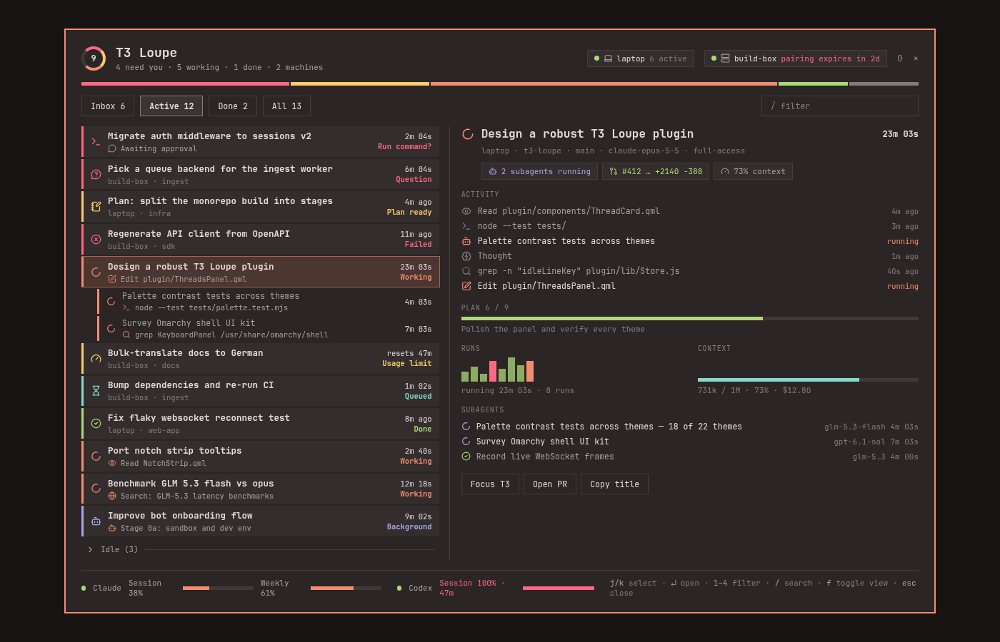
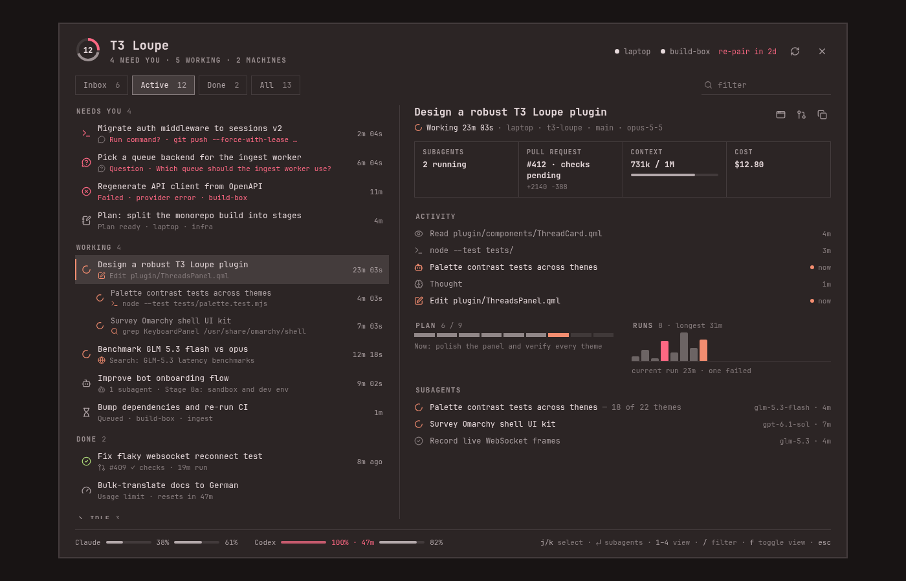
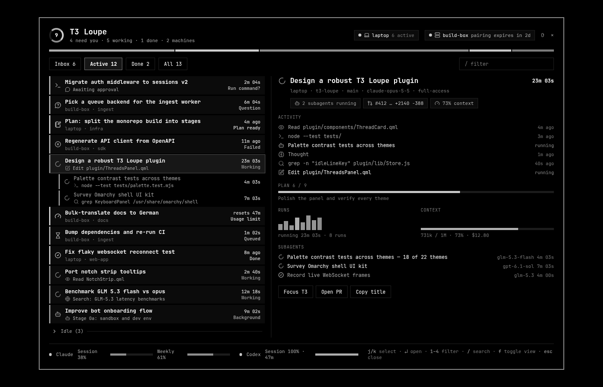
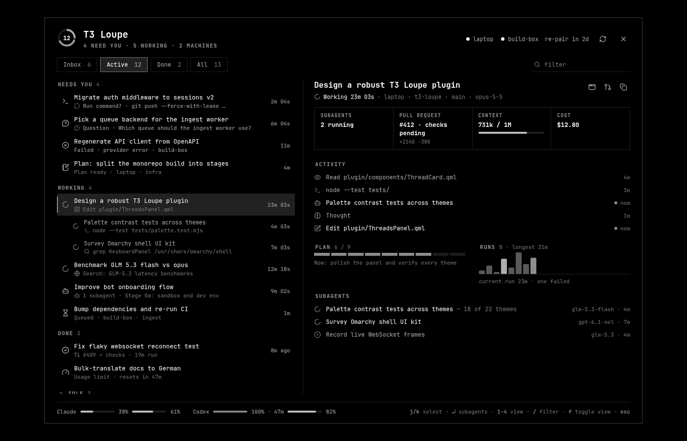
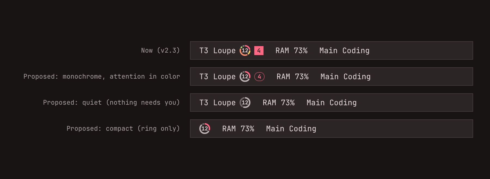

# T3 Loupe: visual design review (v2.3.0)

> **Status:** implemented in v2.4.0 (see VALIDATION.md). The mocks below are the original proposal.

Branch `visual-polish` · 2026-10-12.

**Inputs**
- Live screenshots of the two-pane panel, the dropdown and the bar.
- The Omarchy shell's own conventions: the `dev-gallery`, the first-party `agents` usage panel, `PanelHero`, `PanelSectionHeader` and the `Style` state tokens.
- The dataviz method: form, colour budget, mark specs and the palette validator.

**Mocks.** Each pair below shows the same content before and after: Ristretto and a grayscale theme. They are static mocks, rendered from Loupe's real palette and icons by `tools/mock-polish.mjs`.

| Before (v2.3) | Proposed |
|---|---|
|  |  |
|  |  |

---

## What already works

- **Theme fidelity.** Every colour comes from the theme. Corners follow Hyprland rounding, and the monospace face and the shell's type tokens are used throughout. It never looks foreign.
- **The two-pane structure** is the right form for this job: list plus detail, nothing expands, and the selection stays stable.
- **T3's own activity icons** make the activity lines readable at a glance. This is Loupe's strongest idea.
- **Motion is purposeful.** Spin means working and a pulse means waiting on you, and both respect reduce-motion.

## Findings

### 1. Too many colours carry meaning (highest impact)

**What happens now.** Six state hues (attention, warning, accent, success, info, subagent) each appear up to four times per row: the edge marker, the icon, the state word and the chips. The header adds a ring, a segment bar and a legend in the same hues.

**Why it's a problem.**
- With 12 or more threads the panel looks busy, and colour stops signalling anything.
- Omarchy's first-party panels are almost monochrome: foreground ink, dim ink, and accent or urgent only for an alarm. The agents panel's meters fill with *foreground* and switch to *urgent* only when alarming.
- The dataviz palette validator flags the six-hue set. In Ristretto, info↔success has ΔE 10.9, below the floor of 15 for normal vision. In Catppuccin Latte, subagent↔info has ΔE 4.8 for deuteranopia (red-green colour blindness).
- Themes defeat it outright. Lumon's "red" is blue, and the `gradientwave` theme uses the same colour for accent and red.

**Proposal: a colour budget of three hues.**
- **Attention:** needs input or failed. This is the only coloured *text* allowed, as the alarm exception.
- **Working:** accent, on the icon and on the "live" dot.
- **Done and unseen:** success, on the icon only.

Everything else uses ink: text, dim and faint. Plan-ready, queued, background and usage-limit read through their icon and wording, not a hue. State words stop being coloured, following the dataviz rule that text never takes the data colour.

### 2. Structure should do the job colour is doing now

**Proposal.** Group the Active list under **section headers** (`NEEDS YOU 4`, `WORKING 4`, `DONE 2`, then the `IDLE` fold), in the shell's `PanelSectionHeader` style: bold caption, `darker(fg, 1.4)`, letter-spaced.

**Why.** Urgency then reads from position, not colour, which works in every theme, including monochrome and blue-only ones. It also makes the per-row coloured edges unnecessary.

### 3. The header costs about 180 px and says the same thing three times

**What happens now.**
- Title with a subtitle: "4 need you · 5 working".
- Then a segment bar and legend: "3 blocked · 2 to review · 5 working …".
- Then a row of machine chips.
- Then the tabs.

The ring, the subtitle and the legend all encode the same counts.

**Proposal: a `PanelHero`-style header.**
- Left: the ring as the hero icon, the title, and **one** uppercase meta line (`4 NEED YOU · 5 WORKING · 2 MACHINES`).
- Right: machines as small status dots, then refresh and close.
- Drop the segment bar and legend.

This recovers about 70 px of list in both layouts.

### 4. Selection and hover should use the shell's state tokens

**What happens now.** Loupe uses an accent-tinted fill plus an accent border.

**What the shell provides.** `Style.hoverFillFor` (8%) and `selectedFillFor` (18%), with selected borders off by default.

**Proposal.**
- Use the shell fills: a neutral selected fill and no border.
- Add a 2 px accent marker on the selected row only, since two-pane needs a persistent selection.
- Show hover as its own lighter fill.

This makes the panel look like part of the shell, not an add-on.

### 5. Flat rows, not cards

Every row is currently a filled card with a coloured left edge, which adds a lot of visual weight.

**Proposal.**
- Flat rows on the panel surface, with fill only on hover and selection, like the agents panel's model rows.
- Subagent rows indent without connector lines; the indent is enough.
- In two-pane, row titles use regular weight, not demi-bold. Bold is kept for headers.

### 6. The detail pane needs a top that summarises at a glance

**Proposal.**
- **Header:** the title, then one meta line that leads with the state ("Working 23m 03s · laptop · t3-loupe · main · opus-5-5"). Actions (Focus T3, Open PR, Copy) become **icon buttons on the right of the header**, where `PanelHero` puts its trailing control, not buttons at the bottom.
- **Facts strip:** a 4-cell row of label and value (`SUBAGENTS 2 running`, `PULL REQUEST #412 · checks pending`, `CONTEXT 731k / 1M` with a meter, `COST $12.80`). It replaces the chips and the separate runs/context row. Following the dataviz pattern, a single headline number is better shown as a labelled figure than as a chart.
- **Activity:** the time on the right, and a live dot plus "now" for running steps, not the word "running" in accent.

### 7. Charts: the runs chart is scaled wrongly

These follow the dataviz rules.

- **Runs chart.**
  - Heights currently use a **square-root scale**, which visually exaggerates short runs. Switch to a linear scale with a 2 px minimum.
  - Use **emphasis**: past runs in faint ink, the current run in accent, failures in attention.
  - Add a hairline baseline and a direct label for the extreme ("8 runs · longest 31m"), so the reader isn't judging bar heights alone.
- **Plan progress.** Show **steps**: 9 segments with 2 px gaps, done ones in ink and the current one in accent. This is better than a continuous bar, because step count is the meaningful unit.
- **Meters** (context and usage). Fill with ink (foreground at about 70%) and switch to attention at 90% or more, as the agents panel does. The track becomes a faint tint of the same ink, not a separate grey.
- **Footer usage.** Show one line per provider (`Claude ▬ 38% ▬ 61%   Codex ▬ 100% · 47m ▬ 82%`) beside the key hints, not a 3-row block. This frees roughly 50 px.

### 8. The bar ring: be quiet until something needs you

**What happens now.** A five-colour ring sits beside monochrome neighbours (`RAM 73%`, `Main Coding`), so it's the loudest thing on the bar even when nothing needs attention. The solid red badge adds to that.

**Proposal** (see the bar variants above).
- The ring is drawn in ink: working segments at full ink, idle threads faint. Only the "needs you" segment is coloured.
- The badge becomes an **outlined pill** in the attention colour.
- When nothing needs you, the ring is fully monochrome. Motion still signals work: a slow spin while threads are working.

### 9. Smaller items

- **Type roles** should follow the gallery:
  - panel title → `Style.font.heading` (currently `heading × 1.125`);
  - list row titles → `bodySmall` regular;
  - section captions → `PanelSectionHeader` (bold, `darker(fg, 1.4)`), not faint text with letter-spacing.
- **Tabs:** muted counts ("Active 12", with 12 in faint ink), so the label leads.
- **Search:** an underline field with a magnifier icon, quieter than a boxed input.
- **Time column:** tabular figures, dim ink, no second "state" line; the state is in the subtitle and the section header.
- **Backdrop and border:** the 2 px accent border on the centered card is loud. Use the theme's popup border, or a 1 px line colour, and keep the dimmed backdrop.
- **Single-cursor convention:** the dropdown should not pre-highlight a row (shell convention). Two-pane keeps a selection by design.

## Suggested order of work

| # | Change | Effort | Impact |
|---|---|---|---|
| 1 | Colour budget and neutral state text (findings 1, 8) | S | High |
| 2 | Section headers in Active, flat rows, shell state fills (2, 4, 5) | M | High |
| 3 | `PanelHero` header; drop the segment bar and legend (3) | S | Medium |
| 4 | Detail header with icon actions and a facts strip (6) | M | Medium |
| 5 | Charts: linear runs with emphasis, plan steps, ink meters, one-line footer (7) | S | Medium |
| 6 | Type roles, tabs, search, border (9) | S | Low–medium |

Every item stays within the theme. None adds a colour, and all of them reduce the colour in use.
